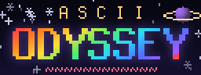
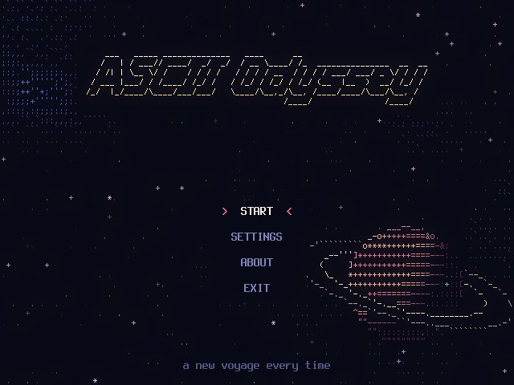
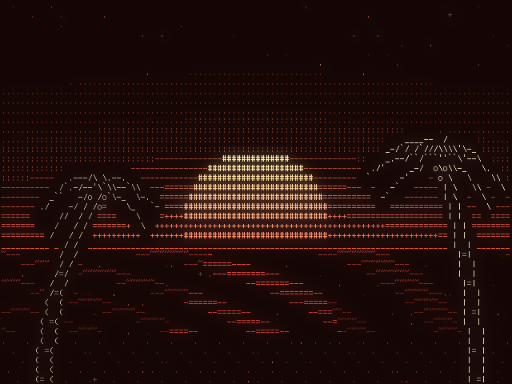

# 

ASCII Odyssey is a Wii app that makes you a brand new voyage every time you press Start: a tracker song composed from a seed, with a light show drawn only in text that dances to the beat.






## Features

- **Ten genres:** 8-bit, 16-bit, ambient, dub, dubstep, keygen, lo-fi, music box, synthwave, and trance.
- **A hundred scenes**, from tunnels and plasma to a game of Tetris, a city at night, and Escher's Circle Limit, with forty kinds of transition between them.
- **Sixty color palettes**, and **fifty FIGlet fonts** for each voyage's title.
- **Every note is written fresh** and played by a tiny tracker, with every instrument synthesized on the Wii.
- **The same seed always sails the same voyage**, so you can share the ones you love.
- **Sail on:** the next voyage composes while this one plays, so it can start the moment this one ends.
- **Accessibility settings** to reduce flashing and motion, and a screen margin for TVs that crop the edges.
- **4:3 and 16:9** aspect ratio compatibility on Wii and vWii

## Seeds

Every voyage grows from a seed, a short name like *violet lagoon*. The seed picks the genre, the tempo, the key, the instruments, the shape of the song, and every picture, so the same seed always makes the same voyage.

Each Start rolls a new seed unless Settings says otherwise: it can sail the last seed again, or a custom seed of your choosing, up to 24 characters. Choosing a genre in Settings gives a seed a different voyage in that genre, so every seed has eleven: its own, and one for each genre.

The last seed is kept in `last_seed.txt`, next to the app.

## Controls

| | Wii Remote | Classic Controller | GameCube controller |
|---|---|---|---|
| Move | D-pad or Nunchuk stick | D-pad or left stick | D-pad or stick |
| Choose | A | A | A |
| Back | B | B | B |
| Pause | + | + | Start |
| Tracker view | 1 | X | X |
| Song info | 2 | Y | Y |
| Volume down / up | − or D-pad down / D-pad up | L / R | L / R |
| Home | HOME | HOME | Z |

During a voyage, Choose or Pause opens the pause menu, Back or Home returns to the title, and the volume buttons turn the music up or down.

## Settings

- **Seed:** random, the last one, or custom.
- **Genre:** any, or one of the ten.
- **Length:** short, medium, or long.
- **After a voyage:** show menu, sail on into a new one, or play it again.
- **Volume**
- **Reduce flashing** and **reduce motion**
- **Glow:** off, soft, or strong.
- **Screen margin:** 0 to 8%, for TVs that crop the edges.
- **Save last seed**

Settings are kept in `settings.txt`, next to the app.

## Installing

Copy the `apps/asciiodyssey/` folder from the release zip to the root of your SD card or USB device, then open ASCII Odyssey from the Homebrew Channel. Updating the same way keeps your settings and last seed.

## Building

ASCII Odyssey builds with devkitPPC and devkitPro's libogc (with libfat), plus Python 3 with Pillow for its font generators:

```
make            # dist/apps/asciiodyssey/boot.dol
make package    # the release zip, in dist/
```

`make pc` builds `build/odyssey-render`, the same core on a PC, which needs zlib. It renders any seed's song to a WAV file, or its voyage to a sheet of frames or, with ffmpeg, a video. `make test` runs the tests.

## Credits

- **FIGlet** and its standard fonts, by Glenn Chappell, Ian Chai, and the FIGlet contributors
- **34 fonts from FIGlet's contributed collection**, each by the people named in [licenses/FIGlet-contributed-fonts.txt](licenses/FIGlet-contributed-fonts.txt)
- **Terminus**, the font behind the text grid, by Dimitar Toshkov Zhekov
- **libogc**, **libfat**, and **devkitPPC** by devkitPro

## License

ASCII Odyssey is free software under the [GNU General Public License, version 3 or later](LICENSE). The fonts keep their own licenses: Terminus is under the SIL Open Font License 1.1, FIGlet and its standard fonts are under FIGlet's BSD-style license, and each contributed font belongs to its authors. All the texts are in [`licenses/`](licenses/).

---

*This project was made with AI assistance. For more information, see [my AI usage statement](https://github.com/cmyksoda/cmyksoda/blob/main/AI_USAGE.md).*
